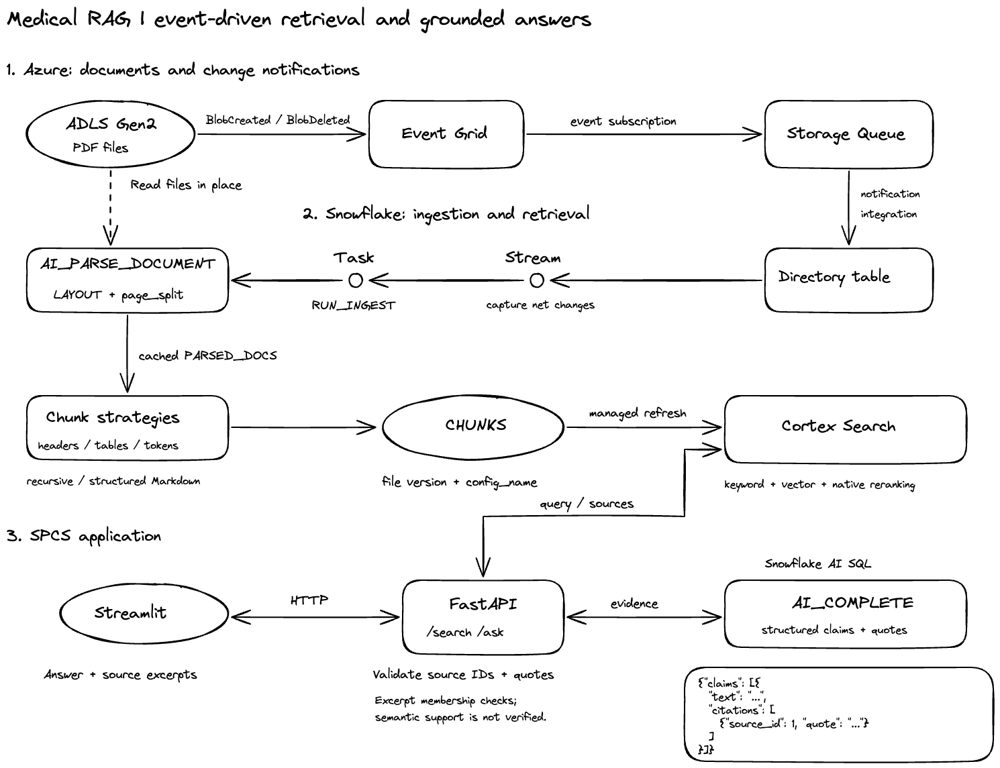

# Medical RAG v2

基于 **Azure ADLS Gen2 与 Snowflake** 的事件驱动医学文献检索与问答应用。项目覆盖文件变更、PDF 解析、增量切分、混合检索、带引用的回答及容器部署，前后端运行在 **Snowpark Container Services（SPCS）**。

系统将文档入库、在线问答和离线评测分开：PDF 保存在 Azure，Snowflake 管理解析结果、不同策略的文档块与搜索索引，FastAPI 和 Streamlit 提供检索与问答界面。

## 主要能力

- **事件驱动入库**：文件新增、覆盖和删除通过 Event Grid、Storage Queue、directory table、Stream 与 Task 驱动处理，无需业务代码轮询对象存储。
- **湖上直接解析**：AI_PARSE_DOCUMENT 直接读取 Azure external stage 中的 PDF，无需先复制到 Snowflake 内部 stage；解析结果按文件版本缓存并复用。
- **结构感知切分**：拼接全文恢复跨页章节，过滤明确的参考文献和出版噪声；8K 配置对正文控制块大小，对摘要和表格优先保留完整证据。不同策略的结果可以共存。
- **混合检索**：Cortex Search 提供关键词、向量及原生重排；multi-index 将完整章节路径作为独立关键词信号，索引与请求权重分别配置。
- **可追溯回答**：模型按结论返回来源编号和原文摘录，后端校验后生成引用标记；前端展示结论、摘录、文件、页码与完整检索片段。
- **独立检索评测**：题集绑定原 PDF、页码和证据，不绑定 chunk_id，可公平比较不同切分与搜索配置。

## 系统架构



[编辑 Excalidraw 图源](docs/assets/architecture.excalidraw)

事件队列传递文件变化，Snowflake 刷新目录元数据，再由 Stream 和 Task 调度增量处理；解析直接读取 Azure 中的 PDF。在线请求由 Streamlit 经 FastAPI 调用 Cortex Search，再将检索证据交给 AI_COMPLETE，生成结构化回答并校验引用。

日常入库与应用统一采用 `structured_markdown_8k_body_1024` 及对应的 8K multi-index 搜索服务。新增文件经事件触发解析、切分后，进入应用使用的索引；索引按一小时 TARGET_LAG 自动刷新。配置选择见 [架构说明](docs/architecture.md)。

## 技术栈

| 层次 | 技术 | 职责 |
|---|---|---|
| 文档与事件 | Azure ADLS Gen2、Event Grid、Storage Queue | 保存 PDF，发布文件变更 |
| 数据处理 | Snowflake SQL、directory tables、Streams、Tasks、Python UDF / UDTF | 捕获变化，解析、切分和维护文档块 |
| 解析与生成 | AI_PARSE_DOCUMENT、AI_COMPLETE | LAYOUT / Markdown 解析，结构化答案生成 |
| 检索 | Cortex Search、Arctic embedding | 托管向量索引、关键词检索与原生重排 |
| 应用 | Python、FastAPI、Pydantic、Streamlit | API、引用校验与交互展示 |
| 部署与基础设施 | Docker、SPCS、Terraform、Snowflake Git repository | 容器运行、资源定义与 SQL 发布 |
| 验证 | pytest、固定 PDF 题集、Snowflake 评测表 | 代码回归和检索质量对照 |

## 项目结构

```text
src/
├── ingestion/sql/             # 文件变化、解析与任务调度
│   ├── config.sql             # 切分配置
│   ├── source.sql             # 外部文件目录与变化流
│   ├── task.sql               # 触发入库流程
│   ├── run_pipeline.sql       # 协调各处理阶段
│   ├── stages/                # 捕获、分类、删除与解析
│   └── chunk/
│       ├── schema.sql         # 文档块表
│       ├── chunk_doc.sql      # 配置分派与事务入口
│       └── strategies/        # recursive 与结构化 Markdown 策略
└── serving/
    ├── cortex_search/         # 按源策略组织的搜索服务定义
    └── medical_rag/
        ├── backend/           # API、连接、提示词、引用校验与服务
        └── frontend/          # 页面、来源渲染与会话管理
eval/                          # 题集构建、检索实验与评分
infra/                         # Azure 与 Snowflake 资源初始化
deploy/                        # Docker 构建与 SPCS 发布
tests/                         # 本地回归与 Snowflake 验收 SQL
docs/                          # 设计说明与实验报告
deploy.sql                     # 入库与搜索 SQL 的发布入口
```

## 运行与部署

本地启动需要 Python 3.12+、已配置的 Snowflake 命名连接及搜索服务：

```sh
python3.12 -m venv .venv
.venv/bin/python -m pip install -e '.[api,ui,dev]'
SNOWFLAKE_CONNECTION_NAME='<connection_name>' .venv/bin/uvicorn medical_rag.backend.api:app --reload
# 另开终端启动前端。
.venv/bin/streamlit run src/serving/medical_rag/frontend/app.py
```

后端提供 `/search`（检索片段）、`/ask`（带引用回答）和 `/healthz`。本地前端地址为 `http://localhost:8501`，API 文档为 `http://localhost:8000/docs`。

云端通过 Docker 镜像部署到 SPCS，仅公开前端，由 Snowflake 身份认证；后端使用挂载 OAuth token 访问 Snowflake。SQL 发布通过 Snowflake Git repository 更新代码副本并执行 `deploy.sql`，评测对象使用独立的 `eval/deploy.sql`。初始化、配置及发布命令见 [部署与验收](docs/deployment.md)。账号、凭据、连接名和公开端点不写入仓库。

## 检索评测

固定语料包含 **209 篇论文**。采用原 PDF 的证据评估单块覆盖和检索排名；以下切分对照使用开发集 `qset_v1` 的 **50 道审核题**，长窗口方案两轮指标一致。

| 指标 | Recursive 基线 | 8K 模型 + 结构化切分 |
|---|---:|---:|
| 证据 Hit@5 | 0.68 | **0.84** |
| 证据 Hit@10 | 0.74 | **0.94** |
| 证据 MRR@10 | 0.439 | **0.686** |
| 单块证据可覆盖率 | 0.86 | **0.98** |

上述对照来自同一套调参题集。2026-10-16 另完成 49 道新审核题的首次评测，并与原题合为固定 99 题集：

| 题集 | 证据 Hit@5 | 证据 Hit@10 | MRR@10 |
|---|---:|---:|---:|
| 原 50 题 | 84.0% | 94.0% | 0.686 |
| 新增 49 题 | 71.4% | 85.7% | 0.466 |
| 合并 99 题 | 77.8% | 89.9% | 0.577 |

新增题的单块覆盖上限为 95.9%，更大的差距在排名，不能用旧 50 题的成绩代表新题表现。8K 方案已用于日常入库和应用；旧方案继续作为对照保留。Hit@k 判断前 k 块中是否有一块覆盖完整证据，不等于标准 Recall@k，也不代表生成答案质量。逐阶段结果、改善与退步的题目见 [实验报告](docs/experiments/README.md)。

引用校验确认来源编号和摘录存在，尚不验证结论与证据的语义支持关系。复杂 PDF 表格解析、跨页续表和失败自动重试仍有边界，详见下方设计文档。

## 文档

- [架构与设计取舍](docs/architecture.md)、[工程难点](docs/challenges.md)
- [切分策略](docs/chunking.md)、[检索与回答](docs/serving.md)
- [初始化、部署与验收](docs/deployment.md)
- [评测流程](eval/README.md)、[实验报告](docs/experiments/README.md)
